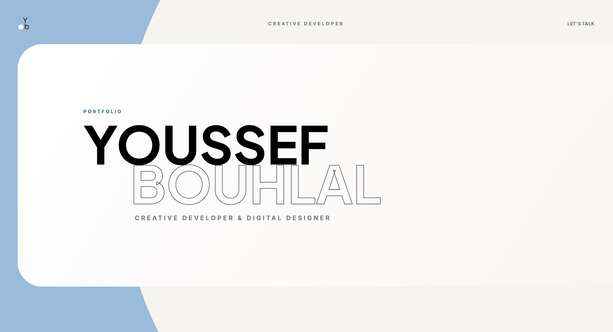

# Youssef Bouhlal - Portfolio

A static portfolio built with HTML, SCSS, and GSAP. WordPress scripts compile the assets; WordPress, PHP, and a database are not required to run the site.

Intended public address: https://youssefbouhlal.github.io/Portfolio/



## Development

Use the Node version in `.nvmrc` (24.22.0) and npm 10.2.3 or newer. With nvm installed:

```sh
nvm install
nvm use
npm ci
npm start
```

`npm start` watches and compiles source changes. Open `index.html` in a browser, or serve this directory with a static HTTP server for HTTP-specific checks. For example, if Python 3 is installed:

```sh
python3 -m http.server 8080 --bind 127.0.0.1
```

Visit http://127.0.0.1:8080/. Stop the server with Ctrl+C.

## Production Checks

```sh
npm run lint:js
npm run lint:css
npm run lint:json
npm run build
git diff --check
```

The build replaces files in `build/`; do not hand-edit generated bundles. Keep `package-lock.json` committed and install with `npm ci`.

The baseline is a normal-flow document. JavaScript enhances it with scroll scenes only when reduced motion is not requested. A preference change or initialization failure restores the baseline. Navigation supports the skip link, section/project fragments, focus destinations, and history. Real-browser, assistive-technology, and touch-device testing is still required before release; source and build checks alone do not prove accessibility.

## Credits and Licensing

Original application code is offered under GPL-2.0-or-later, consistent with `package.json`; see `LICENSE`. This does not relicense dependencies, fonts, photographs, screenshots, logos, or other third-party material. Publication remains blocked until the compatibility/permission review is resolved.

GSAP supplies animation, ScrollTrigger, Observer, and ScrollToPlugin under its own terms. `@wordpress/scripts` supplies build/lint tooling. Google Fonts serves Inter and Plus Jakarta Sans; network requests go to Google's font services. Dependency notices generated with the browser bundle must be retained. See `ASSET-LICENSES.md` for sources, exceptions, and pending approvals.